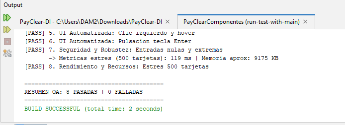
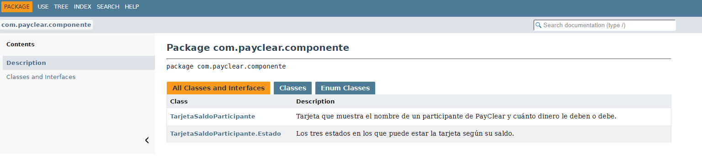

# PayClear - Documentación Técnica - SPRINT 3

* **Módulo:** Desarrollo de Interfaces (DII)
* **Equipo:** Jesús, José Luis, Guillermo
* **Fecha de entrega Sprint 3:** 20/11/2026

### Coevaluación
| Integrante | Nota (%) |
| :--- | :--- |
| Guillermo Eugui | 0% |
| Jesús Cabeza | 0% | 
| JoseLuís Segura | 0% |

## Pruebas, Calidad y Documentación (QA Tester)

**Responsable:** Guillermo Eugui Sánchez

Antes de integrar `TarjetaSaldoParticipante` en las vistas principales de `PayClear`, se ha creado una pila de 8 pruebas automatizadas en `PayClearComponentes/test/TarjetaSaldoParticipanteTest.java` para comprobar que el componente responde bien tanto a nivel de lógica como de interfaz, seguridad y rendimiento.

### Enfoque técnico (Swing nativo frente a TestFX)
**PayClear** está hecho en **Java Swing y FlatLaf**, las interacciones de ratón y teclado se han simulado directamente con el *Event Dispatch Thread* (EDT) usando `SwingUtilities.invokeAndWait`, `MouseEvent` y `KeyEvent`. Así las pruebas corren en Java puro, sin añadir dependencias externas que compliquen la compilación en NetBeans.

### Resumen de los casos probados

| # | Tipo | Qué se comprueba | Resultado |
| :-: | :--- | :--- | :-: |
| 1 | **Unitaria** | Que el constructor por defecto deje valores seguros (`"Participante"`, saldo `0.0`, estado `SALDADO`, color `#59665E` y foco activado). | PASS |
| 2 | **Unitaria** | Que el estado y el color cambien bien a `ACREEDOR` o `DEUDOR`, respetando la tolerancia de `±0.005` para evitar fallos por decimales residuales. | PASS |
| 3 | **Unitaria** | Que `PropertyChangeListener` avise correctamente con el valor antiguo y el nuevo cuando se cambia el nombre o el saldo. | PASS |
| 4 | **Unitaria** | Que los textos de accesibilidad (`AccessibleName` y `AccessibleDescription`) se actualicen para lectores de pantalla como NVDA. | PASS |
| 5 | **UI (Ratón)** | Que al pasar el ratón (`MOUSE_ENTERED` / `MOUSE_EXITED`) cambie el estilo de hover y que el clic izquierdo dispare el `ActionEvent`. | PASS |
| 6 | **UI (Teclado)** | Que pulsar `Enter` sobre la tarjeta dispare el `ActionEvent` para poder usarla sin ratón. | PASS |
| 7 | **Seguridad** | Que ignore nombres nulos o en blanco y colores nulos, y que no lance excepciones con valores límite (`Double.MAX_VALUE`, `Double.NaN`) ni con cadenas con etiquetas HTML. | PASS |
| 8 | **Rendimiento** | Prueba de estrés creando 500 tarjetas seguidas dentro de un `JPanel` para medir tiempo de carga y consumo de memoria. | PASS |

### Salida de las pruebas y métricas
Todas las pruebas han pasado a la primera (`8 PASADAS | 0 FALLADAS`) en 2 segundos. En la prueba de estrés, instanciar **500 tarjetas** ha tardado **119 ms** y ha consumido unos **9.175 KB** (~9 MB de Heap), lo que confirma que el componente es ligero y no bloquea la interfaz.

```text
[PASS] 1. Unitaria: Estado inicial por defecto
[PASS] 2. Unitaria: Estados, colores y tolerancia 0.005
[PASS] 3. Unitaria: Eventos PropertyChangeListener
[PASS] 4. Unitaria: Accesibilidad NVDA
[PASS] 5. UI Automatizada: Clic izquierdo y hover
[PASS] 6. UI Automatizada: Pulsacion tecla Enter
[PASS] 7. Seguridad y Robustez: Entradas nulas y extremas
       -> Metricas estres (500 tarjetas): 119 ms | Memoria aprox: 9175 KB
[PASS] 8. Rendimiento y Recursos: Estres 500 tarjetas


========================================
RESUMEN QA: 8 PASADAS | 0 FALLADAS
========================================
BUILD SUCCESSFUL (total time: 2 seconds)
````




